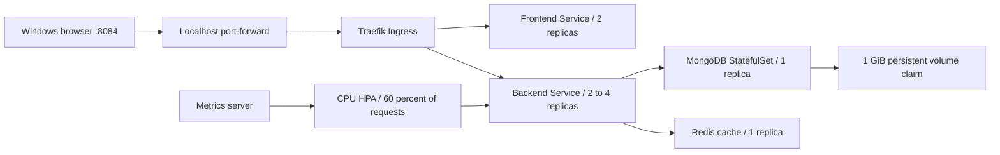

# Architecture and requirement mapping

Everything above runs in the `progree-task4` Minikube profile. Workloads use the
`progree-task4` namespace; the Ingress controller is in `kube-system`. Explicit
contexts in scripts prevent accidental operations against another cluster.

## Availability and elasticity

Frontend and backend have two replicas, readiness/liveness/startup probes,
rolling updates, preferred spreading across nodes, and disruption budgets.
Backend CPU requests are 50 millicores per pod; HPA targets 60% of that request,
with a minimum of two and maximum of four replicas. These small values support a
laptop demonstration and require production load testing before reuse.

HPA adds pods, not nodes. This single-node profile has no cluster autoscaler or
redundant control plane. MongoDB and Redis are single instances. The MongoDB PVC
survives pod replacement, but node/disk loss can still lose data. A disruption
budget controls voluntary eviction; it cannot prevent crashes or node failures.

A production HA design would use a managed multi-zone control plane, multiple
worker nodes across zones, replicated database with backups, appropriate shared
or replicated storage, redundant ingress, TLS, network-policy enforcement, and
capacity-aware node autoscaling. These are design considerations, not claims
about the local demonstration.

## Networking and secrets

Ingress routes `/api` and `/health` to the backend and `/` to the frontend.
Only the forwarding process binds localhost on Windows. MongoDB and Redis use
ClusterIP services with no host port. The kindnet CNI does not enforce Kubernetes
NetworkPolicy; a namespace alone is not a network security boundary.

Generated credentials stay in ignored `.secrets/`. Deployment sends them through
stdin into a Kubernetes Secret, then mounts only the required keys into each
workload. Kubernetes Secrets are not encryption by themselves; anyone with
cluster-admin access can read them. Service-account token mounting is disabled
for app workloads. Stateless app containers run as non-root with read-only root
filesystems and dropped capabilities. MongoDB uses its image's initialization
entrypoint and writable persistent data directory.

## Declarative cloud networking

[The optional AWS network blueprint](../infra/aws-network/README.md) defines a VPC
and four subnets across two zones with separate route tables. Its private subnets
have local-only routing. It is validated locally with mocked provider tests.
There is no AWS deployment, EKS cluster, cloud connectivity, or real cloud plan.
The local Minikube network and this undeployed blueprint are separate environments.

## Application attribution and limits

Wanderlust by Krishna R Acharya and contributors is retained under [MIT](../LICENSE).
Application sources derive from the user's standalone Task 3 revision `e2fa80a`;
Task 4 changes its delivery and orchestration. The post API lacks authorization
and the sign-in screens are not fully integrated. This is a localhost internship
demo, not a production-ready public application.
